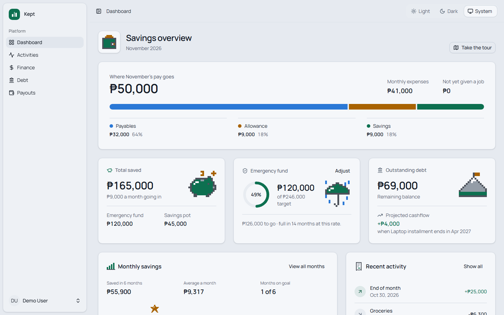
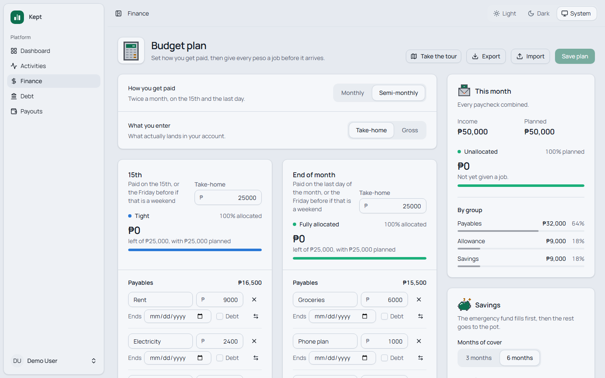
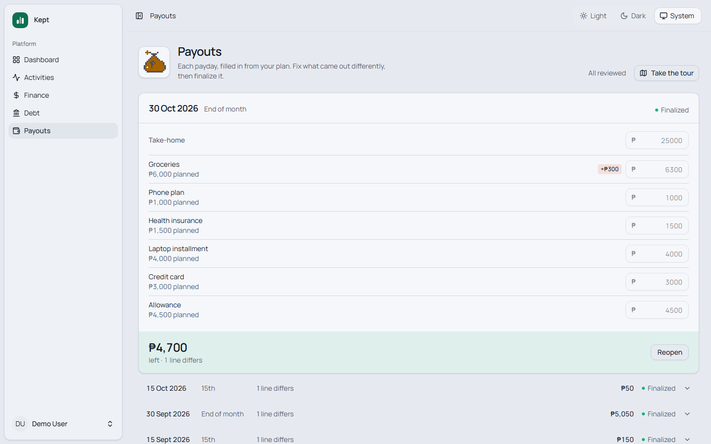
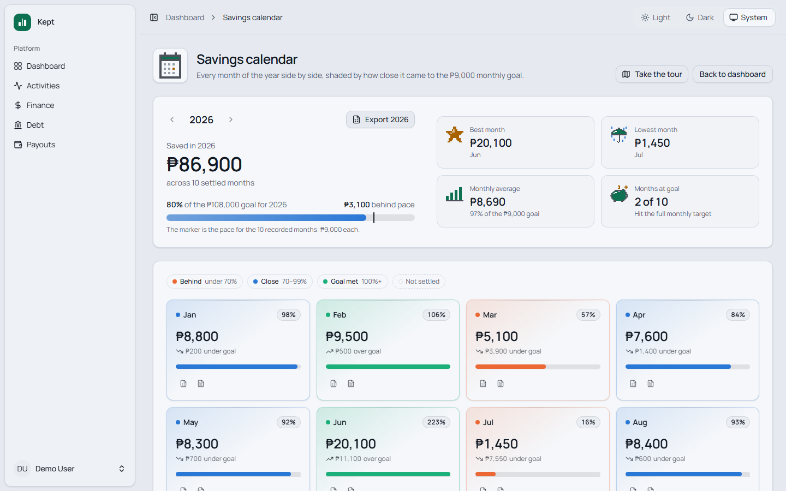
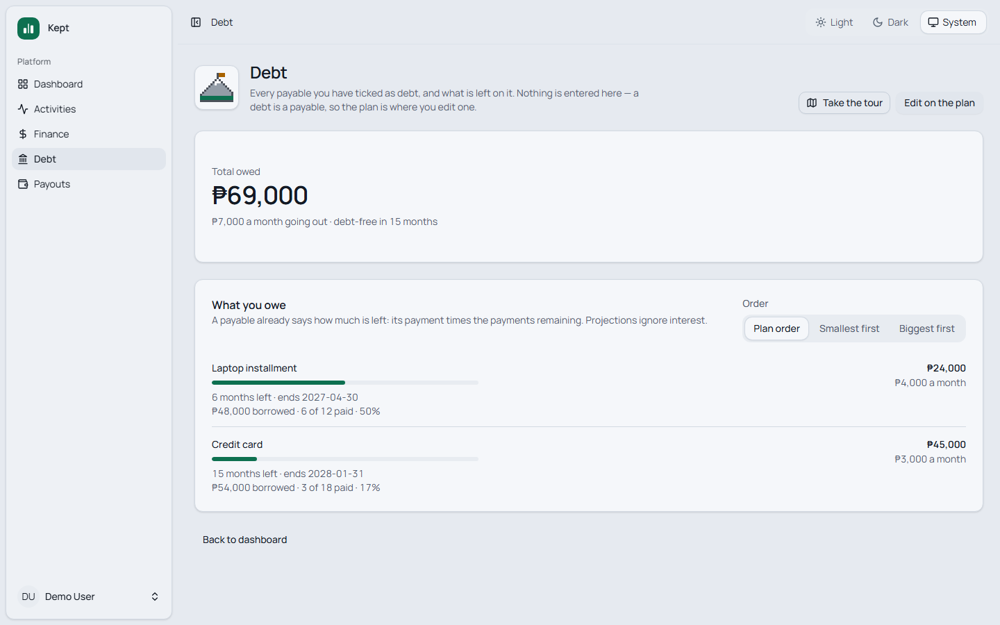
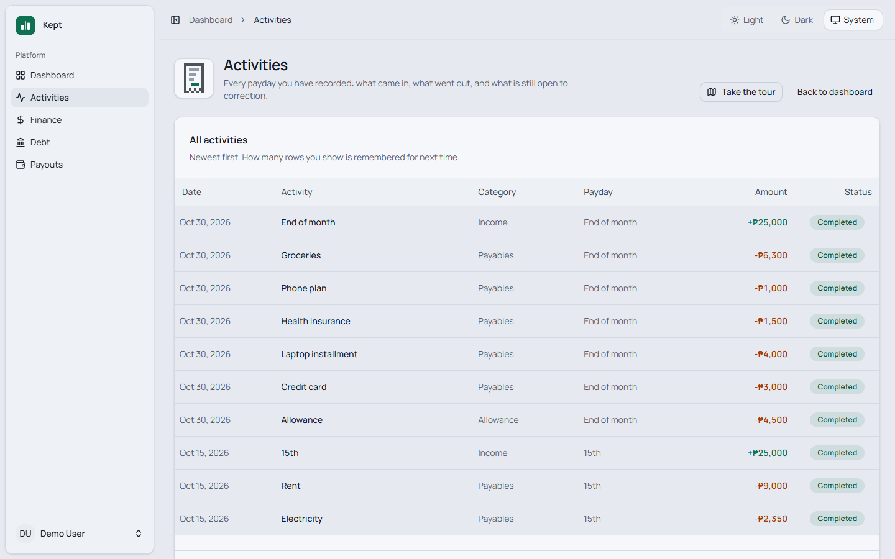
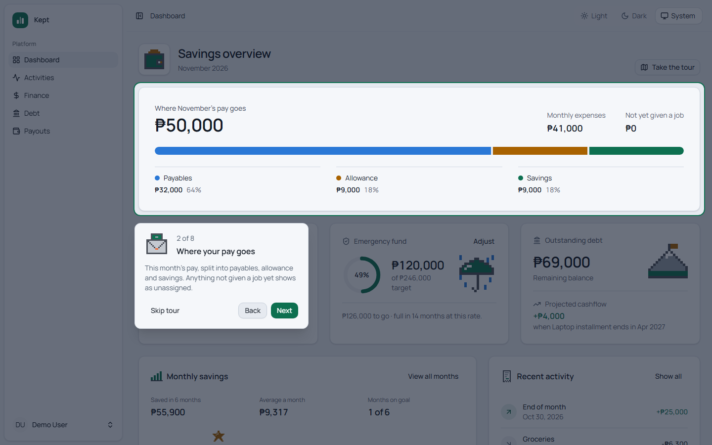

  

  <h1>Kept</h1>

  
<strong>Plan what comes in. Record what goes out.</strong>

  

    A personal finance planner for people paid once or twice a month. 
    Give every peso a job before payday, then see what you actually saved.
  

  

    
    
  

  

    <a href="#features">Features</a>
    &nbsp;·&nbsp;
    <a href="#how-it-works">How it works</a>
    &nbsp;·&nbsp;
    <a href="#a-closer-look">Screenshots</a>
    &nbsp;·&nbsp;
    <a href="#built-with">Built with</a>
  

 

<picture>
  <source media="(prefers-color-scheme: dark)" srcset=".github/readme/dashboard-dark.png">
  
</picture>

 

## Features

<table>
  <tr>
    <td width="33%" valign="top">
      <h3>Give every peso a job</h3>
      Split each paycheck into payables, allowance and savings. Enter your gross
      and SSS, PhilHealth, Pag-IBIG and tax are worked out for you.
    </td>
    <td width="33%" valign="top">
      <h3>Check each payday</h3>
      Paydays open by themselves, filled in from your plan. Fix what came out
      different, then finalize.
    </td>
    <td width="33%" valign="top">
      <h3>See every month</h3>
      A savings calendar graded against your goal, with any month as a
      spreadsheet or a PDF.
    </td>
  </tr>
  <tr>
    <td width="33%" valign="top">
      <h3>Watch debt go down</h3>
      What is left on each debt, how far through you are, and when you will be
      free of it.
    </td>
    <td width="33%" valign="top">
      <h3>Every peso in and out</h3>
      One log of each payday's income and spending, with anything unplanned
      tagged.
    </td>
    <td width="33%" valign="top">
      <h3>A tour of every page</h3>
      Short walkthroughs, shown over sample data when you are just starting
      out.
    </td>
  </tr>
</table>

Also: payday reminders by email, two-factor authentication and passkeys, and
light and dark themes.

## How it works

<table>
  <tr>
    <td width="33%" valign="top" align="center">
      <h3>1 · Plan</h3>
      Say what each paycheck is for, before it arrives.
    </td>
    <td width="33%" valign="top" align="center">
      <h3>2 · Review</h3>
      Each payday opens from the plan. Correct it and finalize.
    </td>
    <td width="33%" valign="top" align="center">
      <h3>3 · Look back</h3>
      Finalized paydays become your history, month by month.
    </td>
  </tr>
</table>

Each payday keeps its own copy of the plan, so changing your plan later never
rewrites a month that already happened.

## A closer look

<table>
  <tr>
    <td width="50%" valign="top">
      <picture>
        <source media="(prefers-color-scheme: dark)" srcset=".github/readme/plan-dark.png">
        
      </picture>
      
<strong>Budget plan</strong> Two paychecks, each with its own jobs

    </td>
    <td width="50%" valign="top">
      <picture>
        <source media="(prefers-color-scheme: dark)" srcset=".github/readme/payouts-dark.png">
        
      </picture>
      
<strong>Paydays</strong> What the plan said, next to what happened

    </td>
  </tr>
  <tr>
    <td width="50%" valign="top">
      <picture>
        <source media="(prefers-color-scheme: dark)" srcset=".github/readme/calendar-dark.png">
        
      </picture>
      
<strong>Savings calendar</strong> The whole year, graded against your goal

    </td>
    <td width="50%" valign="top">
      <picture>
        <source media="(prefers-color-scheme: dark)" srcset=".github/readme/debt-dark.png">
        
      </picture>
      
<strong>Debt</strong> What is left, and when it will be gone

    </td>
  </tr>
  <tr>
    <td width="50%" valign="top">
      <picture>
        <source media="(prefers-color-scheme: dark)" srcset=".github/readme/activities-dark.png">
        
      </picture>
      
<strong>Activity log</strong> Every peso in and out, newest first

    </td>
    <td width="50%" valign="top">
      <picture>
        <source media="(prefers-color-scheme: dark)" srcset=".github/readme/walkthrough-dark.png">
        
      </picture>
      
<strong>Walkthroughs</strong> A guided tour the first time you open a page

    </td>
  </tr>
</table>

Click any screenshot to see it full size.

## Built with

  
  
  
  
  
  
  

  
  
  
  
  

Sign-in is handled by Laravel Fortify, spreadsheets by PhpSpreadsheet, and PDFs
by headless Chromium. Local email goes to Mailpit.

## License

MIT.
